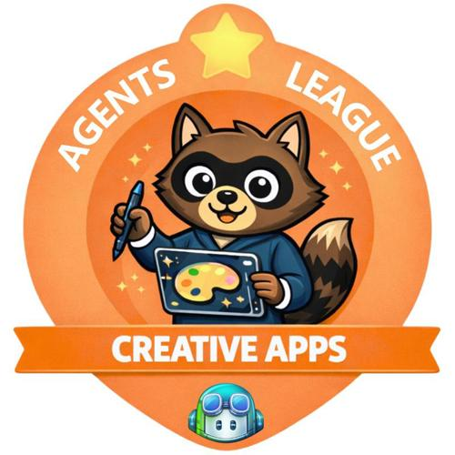

# CurriculumCraft AI 🇬🇭



> An AI-powered instructional design platform for Ghanaian Primary and JHS teachers that transforms NaCCA Standards-Based Curriculum indicators into scaffolded lesson materials, visual content prompts, and interactive student activities.

🏆 **Top Student Winner — Microsoft Agents League Hackathon (Creative Apps Track)**

🔗 **Live Demo**: [curriculumcraft-ai.vercel.app](https://curriculumcraft-ai.vercel.app)

---

## The Problem

Ghanaian Junior High School teachers spend hours every week manually converting dense NaCCA curriculum documents into lesson plans. The Standards-Based Curriculum (SBC) introduced by Ghana's National Council for Curriculum and Assessment (NaCCA) is rigorous and well-structured — but translating its indicators into classroom-ready materials is time-consuming and administratively burdensome.

Teachers in under-resourced schools outside Accra face this challenge with limited planning time, large class sizes of 40–60 students, and minimal support. CurriculumCraft AI eliminates that burden.

---

## The Solution

CurriculumCraft AI transforms any NaCCA curriculum indicator into three complete, classroom-ready outputs in seconds:

- **Teacher Notes** — lesson plan with timings, learning objectives, key vocabulary, common misconceptions, and differentiation tips
- **Visual Content Prompts** — 4 practical visual aids a teacher can create with minimal resources
- **Student Reading Material** — a Ghanaian-context reading passage with worked examples and comprehension questions

Every generated output uses authentic Ghanaian cultural context — local names (Ama, Kofi, Adjoa), local settings (Kumasi Central Market, Cape Coast, Ashanti cocoa farms), Ghana Cedis, and local foods.

---

## Three Views

### 1. Standard Map Dashboard
Browse the available NaCCA curriculum tree across Primary and JHS. Primary uses official B1-B6 codes while P1-P6 remain accepted aliases. Every strand, sub-strand and indicator is searchable. Click any indicator to instantly launch the Lesson Builder.

### 2. Lesson & Material Builder
Select a subject, grade, strand and indicator. Configure lesson duration and class size. Generate complete teacher notes, visual prompts and student reading material — all grounded in the NaCCA curriculum via Microsoft Foundry IQ.

### 3. Interactive Activity Suite
Generate 5 multiple-choice questions (with interactive answer checking and explanations), 2 writing prompts with sample answers, and a 4-criterion assessment rubric — all aligned to the selected NaCCA indicator.

---

## Tech Stack

| Layer | Technology |
|---|---|
| Frontend | Next.js 16 (App Router), Tailwind CSS v4, shadcn/ui |
| Backend | Next.js API Routes (Server-side) |
| Database | Neon PostgreSQL (serverless) |
| ORM | Drizzle ORM |
| AI Generation | GitHub Models API (gpt-4o-mini) |
| Microsoft IQ | Azure Microsoft Foundry IQ — grounding layer for NaCCA curriculum context |
| AI-Assisted Dev | GitHub Copilot (VS Code) |
| Deployment | Vercel |
| Language | TypeScript |

---

## Microsoft IQ Integration

This project integrates **Microsoft Foundry IQ** as the intelligence grounding layer for the Creative Apps track requirement.

### Architecture
Before generating lesson materials, the app queries the Microsoft Foundry IQ endpoint to retrieve grounded NaCCA curriculum context. This grounds the AI generation in actual curriculum standards, reducing hallucination and ensuring generated content is anchored to the real NaCCA SBC indicators.

### Implementation
The Foundry IQ integration is fully implemented in `app/api/generate/route.ts`:

```ts
// Foundry IQ grounding — retrieves relevant NaCCA context
async function getFoundryContext(
  indicatorCode: string,
  indicatorText: string,
  subject: string
): Promise<string | null>
```

The integration:
- Calls the Agents League Foundry IQ hub endpoint
- Requests curriculum-specific context for the selected NaCCA indicator
- Passes the grounded context to the generation layer as additional prompt context
- Gracefully falls back to direct generation if the endpoint is unavailable

### Foundry IQ Endpoint
- **Hub**: `hub-agents-league.services.ai.azure.com`
- **Project**: `proj-default`
- **Endpoint**: `https://hub-agents-league.services.ai.azure.com/api/projects/proj-default`

### Environment Variables Required
```env
AZURE_FOUNDRY_ENDPOINT=https://hub-agents-league.services.ai.azure.com/api/projects/proj-default
AZURE_FOUNDRY_API_KEY=your_foundry_api_key_here
AZURE_FOUNDRY_PROJECT_ID=proj-default
```

### Note on Quota
The Agents League Foundry hub operates with shared quota across all hackathon participants. During periods of high demand or quota exhaustion, the app gracefully degrades to direct generation while maintaining full functionality. The Foundry IQ integration code remains active and will utilize grounding when quota is available.

---

## GitHub Copilot Usage

GitHub Copilot was used throughout the development of this project in VS Code:

- **Database schema** — Copilot generated the Drizzle ORM schema for the 5-table NaCCA curriculum database
- **API routes** — All four API routes scaffolded with Copilot inline completions
- **TypeScript types** — Full type definitions generated via Copilot Chat
- **Component structure** — SubjectSelector, SectionCard, MarkdownRenderer components built with Copilot suggestions
- **Prompt engineering** — System prompts in `prompts/lesson.ts` and `prompts/activity.ts` refined with Copilot
- **Bug fixes** — ESLint and TypeScript errors resolved using Copilot Chat explanations

---

## NaCCA Curriculum Coverage

**Primary (B1-B6)** - imported from the 2019 Standards-Based Curriculum books:
English Language, Mathematics, Science, Computing, French, Ghanaian Language,
History, Our World and Our People, Physical Education, Religious and Moral
Education.

**JHS (B7-B9)** - imported from the 2021 Common Core Programme (CCP) books on
[nacca.gov.gh](https://nacca.gov.gh/common-core-programme/), one approved
release per subject, every subject on NaCCA's CCP list:

| Subject | Grades | Indicators | Exemplars |
|---|---|---|---|
| English Language | B7, B8, B9 | 152 | 450 |
| Mathematics | B7, B8, B9 | 178 | 463 |
| Science | B7, B8, B9 | 154 | 398 |
| Social Studies | B7, B8, B9 | 54 | 299 |
| Computing | B7, B8, B9 | 132 | 308 |
| Career Technology | B7, B8, B9 | 135 | 714 |
| Religious and Moral Education | B7, B8, B9 | 68 | 127 |
| Creative Arts and Design | B7, B8, B9 | 100 | 248 |
| Physical Education and Health | B7, B8, B9 | 54 | 182 |
| Ghanaian Language | B7, B8, B9 | 104 | 296 |
| French | B7, B8, B9 | 166 | 681 |
| Arabic | B7, B8, B9 | 199 | 201 |

Every JHS row carries its content standard, core competencies, source page,
raw source text and document checksum. Rows the extractor could not settle
(a number the book reuses, a heading the book omits) are imported anyway and
marked `needs-review` with the reason in `source_reference`.

To rebuild the JHS envelopes from the official PDFs:

```bash
# Put each CCP PDF in %TEMP%/nacca-jhs-ccp/<key>.pdf (keys in db/extract-jhs-ccp.ts)
# and convert it: pdftotext -layout -enc UTF-8 <key>.pdf <key>.txt
npm run curriculum:extract-jhs                      # writes jhs-<key>-2021.json per subject
npm run curriculum:import -- $TEMP/nacca-jhs-ccp/jhs-mathematics-2021.json --dry-run
npm run curriculum:validate -- --level JHS          # per-subject counts and cross-subject checks
```

---

## Local Setup

### Prerequisites
- Node.js 18+
- A Neon PostgreSQL database
- A GitHub Personal Access Token with `models` permission
- An Azure AI Foundry project endpoint and API key

### Installation

```bash
# Clone the repository
git clone https://github.com/YOUR_USERNAME/curriculumcraft-ai.git
cd curriculumcraft-ai

# Install dependencies
npm install

# Set up environment variables
cp .env.example .env.local
# Fill in your keys in .env.local

# Push database schema
npm run db:push

# Seed NaCCA curriculum data
npm run db:seed

# Validate, then import an authoritative CSV or JSON curriculum release
npm run curriculum:import -- path/to/curriculum.json --dry-run
npm run curriculum:import -- path/to/curriculum.json

# Start development server
npm run dev
```

Visit `http://localhost:3000`

### Teacher accounts and private resources

Authentication uses the existing Neon PostgreSQL database and Drizzle ORM;
no external authentication provider is required. The old beta access-code
endpoint, cookie validation, access page, and feature-blocking overlay have
been removed. Public product pages remain public. Teacher tools and their
APIs require a valid account session.

The header groups Scheme of Learning, Lesson Builder, Activity Suite, and
Standard Map under **Teaching tools**. Signed-in teachers have a direct
**My library** link; profile, classroom settings, and sign-out are grouped in
**My account**. Phones and tablets use an accessible, scrollable side panel
with the same destinations.

### Teacher feedback

The floating **Feedback** button opens a keyboard-accessible panel with five
feedback categories and a message field. Public visitors and signed-in teachers
use the same existing Google Form; no account details are automatically shared.
**Send Feedback** opens that form with the category and message pre-filled.
Teachers must complete the form's required questions and submit there; opening
it is not a successful submission. The panel retains the draft across closing
and reopening during the current visit.

`NEXT_PUBLIC_FEEDBACK_FORM_URL` must be the full Google Forms `viewform` URL,
not a shortened link. Question entry IDs are mapped in `lib/feedback.ts` to
the current form's problems, improvements, new-feature, and experience questions.
Update those mappings if the form's questions change. No new database, API,
or feedback service is introduced. The button stays above the announcement
bar using its measured height and is hidden on authentication pages.

### Product announcements

The global bottom announcement bar rotates through four messages every six
seconds. All copy, the October 31 early-access date, the GH₵10/month price,
and rotation interval live in `lib/announcements.ts`.
CTA buttons open a product-direction dialog, not a payment flow or unfinished
news/CPD system.

Dots select an announcement manually. Rotation pauses on hover, keyboard
focus, hidden browser tabs, and while the roadmap is open. Text and CTA labels
crossfade over 600ms with a subtle vertical ease. Overlapping grid slides reserve
space for the longest message, so rotation never changes the bar's height or
CTA width. There are no close or pause/play controls; reduced-motion preferences
disable automatic rotation and transitions. The banner is always visible on screen and cannot be
dismissed by users. Previously saved dismissal preferences are ignored.

The banner measures its rendered height to reserve matching bottom space,
respect device safe areas, and lift the existing feedback button clear of it.
It and its spacer are omitted from printed teaching resources.

Apply the additive migration to an existing database before deploying:

```bash
npm run db:migrate
```

Migration `0011_teacher_accounts.sql` adds `teacher_accounts`,
`teacher_sessions`, `auth_rate_limits`, and `saved_resources`, and adds
indexed `user_id` foreign keys to `saved_lessons` and `scheme_uploads`.
It does not delete, change, or assign ownership to existing records. Legacy
ownerless lessons and schemes remain in the database but are excluded from
account libraries. Do not use `db:push` instead of the migration on an existing
deployment.

Passwords are salted and hashed with scrypt. Random session tokens live in
HttpOnly, SameSite=Lax cookies (Secure in production), expire after 30 days,
and are stored only as SHA-256 hashes in the database. Logout revokes the
server session. Authentication attempts are limited atomically in PostgreSQL.
Mutation endpoints require a matching Origin header; private APIs derive
ownership from the verified session, never from a client-supplied user ID.
Ownership is enforced by SQL predicates in API queries, including scheme
review, deletion, and week generation. Database credentials must remain
server-only; the browser never connects directly to PostgreSQL.

Required authentication environment variables:

- `DATABASE_URL`: the existing Neon connection string.
- `NEXT_PUBLIC_APP_URL`: the exact origin, such as `http://localhost:3000`
  locally or the HTTPS production origin. Update it if using a different
  local port. Cross-origin mutation requests are intentionally rejected.

No new provider keys or session-signing secret are needed. Remove any obsolete
`BETA_ACCESS_CODE` from deployment settings; the app no longer reads it.
Existing AI environment variables are still needed for generation.

To test locally:

1. Start the app with `npm run dev`, then visit `/sign-up`.
2. Create a teacher account with a name, email, and password of 12–128
   characters. Registration signs you in immediately.
3. Open each navigation tool, including Scheme of Learning. No access code
   should be requested. Reload the page and confirm you remain signed in.
4. Generate a lesson in Lesson Builder and save it. Generate activities or
   scheme lessons and use their **Save to library** buttons. Open `/saved`
   to view lesson plans, notes, reading materials, and assessment resources.
5. Edit your name in `/account`. Email and join date are also shown.
   Classroom location settings remain account-namespaced browser preferences,
   not a cloud-synced profile setting.
6. Sign out and verify protected pages redirect to sign-in and private APIs
   return 401. Sign in again and confirm your library persists.
7. Use a second account/private browser window. Confirm the first account's
   resources and schemes are not listed and their direct API identifiers
   return 404. Delete only resources belonging to the signed-in account.

Automated verification:

```bash
npm test
npm run build
# Against a running LOCAL server; creates two clearly labelled test accounts.
# Choose an absolute manifest path outside the repository.
npx tsx scripts/auth-smoke-test.ts C:\Temp\curriculumcraft-auth-test.json
```

The smoke test intentionally retains its accounts/resources for review and
writes their exact IDs to the supplied manifest. It does not auto-delete
accounts. Review and explicitly approve test-record cleanup before deleting
anything. Email verification, password recovery, and MFA are not included in
this initial account release.

See [Curriculum Architecture](./docs/curriculum-architecture.md) for the data model,
import contract, exemplar CSV/JSON examples, API behavior, and production migration
sequence.

### Environment Variables

```env
DATABASE_URL=your_neon_connection_string
AZURE_FOUNDRY_ENDPOINT=your_foundry_project_endpoint
AZURE_FOUNDRY_API_KEY=your_foundry_api_key
NEXT_PUBLIC_APP_URL=http://localhost:3000
```

Generation runs on Azure AI Foundry through its OpenAI-compatible endpoint
(`{resource}/openai/v1`). The model named in `lib/claude.ts` must be **deployed**
on that resource — a model can appear in the Foundry catalogue and still return
`DeploymentNotFound` if nobody has deployed it.

---

## Architecture

```
User (Ghanaian Teacher)
        │
        ▼
Next.js 15 Frontend (Vercel)
├── Standard Map Dashboard
├── Lesson & Material Builder
└── Interactive Activity Suite
        │
        ▼
Next.js API Routes
├── /api/curriculum     → Neon PostgreSQL (NaCCA seed data)
├── /api/generate       → Foundry IQ grounding → GitHub Models (gpt-4o-mini)
├── /api/generate/activity → GitHub Models (gpt-4o-mini)
└── /api/lessons        → Neon PostgreSQL (saved lessons)
        │
        ├── Microsoft Foundry IQ (grounding layer)
        └── GitHub Models API (generation layer)
```

---

## Impact

CurriculumCraft AI directly addresses teacher burnout in Ghana's JHS system by eliminating hours of manual lesson planning. With 4 subjects, 3 grade levels, and 50+ NaCCA indicators covered, the platform can support thousands of Ghanaian teachers — particularly those in under-resourced schools outside major cities who lack curriculum support infrastructure.

---

## License

MIT © 2026 — Built with ❤️ for Ghana's teachers
